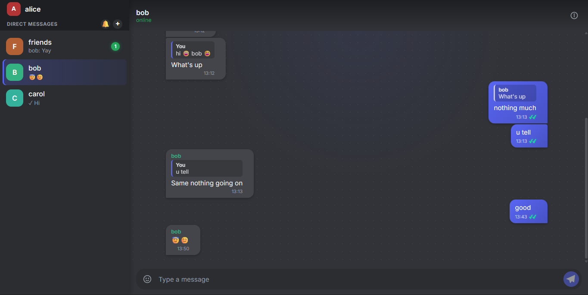
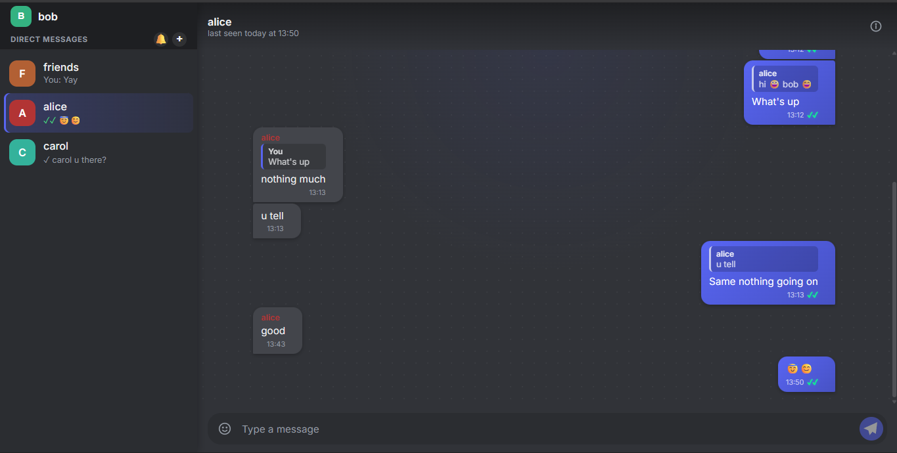

# Chat App

**Live demo:** [Chat App](https://chat-app-pw.vercel.app)
*(Note: the backend is on a free-tier host and may take up to a minute to wake up on first load.)*

A real-time chat application with authentication, DMs, groups, friend requests, replies, emoji reactions, and live messaging — built with React, Node/Express, Socket.IO, and MongoDB.

- [`/client`](./client) — React frontend ([setup instructions](./client/README.md))
- [`/server`](./server) — Express + Socket.IO backend ([setup instructions](./server/README.md))

## Features

- **Accounts:** signup/login with JWT sessions and bcrypt-hashed passwords
- **Chats:** one-to-one DMs (gated by accepted friend requests) and group chats with member management
- **Live messaging:** instant delivery over Socket.IO, typing indicators, online status and "last seen", sent / delivered / read ticks, unread badges and sidebar previews
- **Replies:** reply to any message; the quote updates live if the original is edited or deleted, and tapping it jumps to the original
- **Emoji picker:** scrollable category picker in the composer, with a "recently used" section
- **Reactions:** react with one of six emoji (one reaction per person per message), visible to everyone in the chat in real time
- **Message actions:** edit (15-minute window) and delete for everyone, from a per-message ⋮ menu
- **Mobile friendly:** responsive layout with a sidebar drawer and swipe-right-to-reply
- **Contact info:** friend profile with last seen and shared groups
- **Housekeeping:** delete chat (hide for yourself) and delete account

## Tech stack

| Layer    | Tools                                                                             |
| -------- | --------------------------------------------------------------------------------- |
| Frontend | React (Vite), Socket.IO client, plain CSS                                         |
| Backend  | Node.js, Express, Socket.IO                                                       |
| Database | MongoDB (Mongoose)                                                                |
| Security | JWT, bcrypt, Helmet, rate limiting, CORS locked to one origin                     | 
| Hosting  | Vercel (frontend), Render (backend), MongoDB Atlas                                |
| Testing  | Vitest, Supertest, Socket.IO client, mongodb-memory-server, React Testing Library |

## Quick start

1. Set up and run the backend: see `server/README.md`
2. Set up and run the frontend: see `client/README.md`
3. Visit the frontend URL in your browser

## Testing

About 165 automated tests cover the server and the client.

| Part                    | Tools                                                      | What is covered |
| ----------------------- | ---------------------------------------------------------- | --------------- |
| Server (`server/tests`) | Vitest, Supertest, Socket.IO client, mongodb-memory-server | Auth rules, friend requests, friend-gated DMs, real-time messaging, replies, edit window, sender-only delete, reactions, rate limiting |
| Client (`client/src`)   | Vitest, React Testing Library, user-event, jsdom           | Helper functions, composer and emoji picker, message list, message menu, editing, swipe-to-reply |

Run them with `npm test` inside `server/` and inside `client/`. The server tests use a throwaway in-memory MongoDB, so they never touch real data.

## Known limitations

- **No refresh tokens** — JWTs expire after 7 days with no silent renewal; users are simply logged out and must sign in again. A deliberate scope decision for a project at this size.
- **Message editing has a 15-minute window** — matching WhatsApp's convention; messages older than that can only be deleted, not edited.
- **No "delete for me" option** — message deletion is permanent and visible to everyone in the conversation, by design.
- **Deleted accounts aren't fully erased from history** — a deleted user's past messages remain visible (shown under their old username) in any conversation that isn't itself deleted, since removing them would corrupt other members' chat history. DMs with a deleted user can be removed entirely via "Delete chat."
- **Only 100 messages load per conversation** — there is no pagination or infinite scroll yet. A reply to a message older than that still shows its quote, but tapping it can't jump to the original.
- **Reactions use a fixed set of six emoji** — the composer has an emoji picker for messages, but reactions deliberately stay limited to the fixed set.
- **Text only** — no file, photo, or sticker sharing.
- **No group invite links yet** — new members are added directly by any existing group member; link-based invites are a possible future addition.
- **No end-to-end browser tests** — the project has unit and integration tests for the server and the client components, but nothing that drives a real browser.
- **Free-tier hosting cold starts** — the backend (Render free tier) sleeps after ~15 minutes of inactivity; the first request after that can take up to a minute to respond. The login screen detects this and shows a "waking up" message rather than appearing frozen.